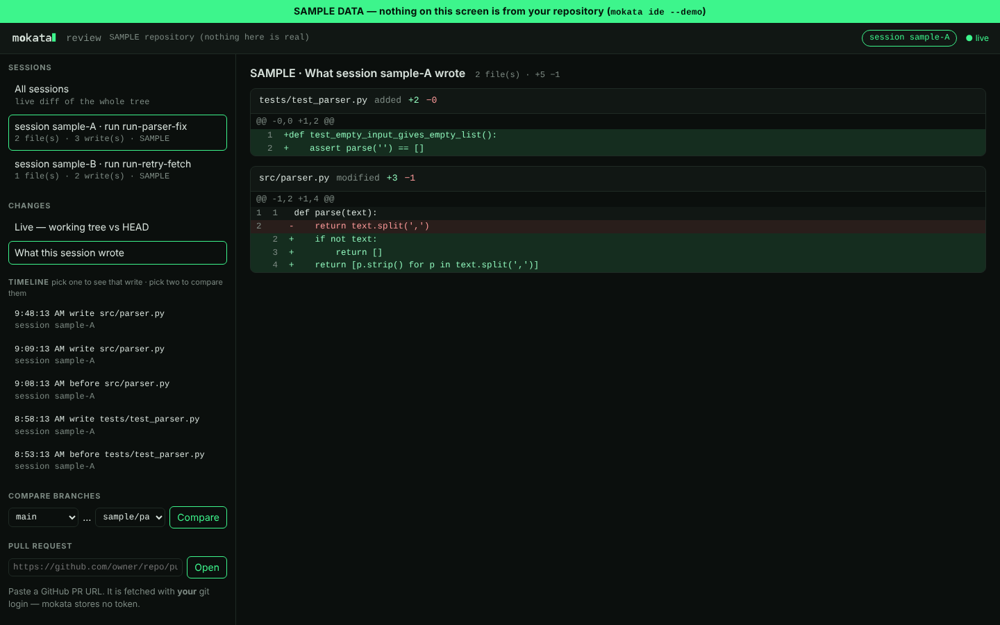

# Review what your agent wrote (`mokata ide`)

`mokata ide` opens the **review window**: a read-only page on your own machine that shows exactly
what changed, who changed it, and when. It is built for supervising agent work — checking a
session's writes before you approve or ship them — not for editing.



## Open it

From inside a Claude Code session, type:

```text
/review-window
```

mokata's prompt hook opens the window in your browser and focuses it on **that session** — its
run, the files it wrote, its timeline. If a window is already open for the repository, it is
re-focused instead of a second one being started. Running several sessions in parallel? Each one
is its own row; type the command in a session to point the window at it.

From a terminal:

```bash
mokata ide                 # open (or re-focus) the window for this repository
mokata ide --session ID    # focus a particular session
mokata ide --demo          # a clearly labelled SAMPLE dataset, to look around first
```

The window needs the `[ide]` extra, which is normally already present with mokata's MCP SDK. If it
is missing, mokata prints the one line to install it: `pip install "mokata[ide]"`.

## What it shows

- **Live changes** — the working tree against `HEAD`, uncommitted and untracked files included,
  updating as sessions write.
- **What a session wrote** — for every file a session touched, its content before the session's
  first write against its latest one. This is "what is coded by this session", even when several
  sessions share the repository.
- **Timeline** — every write a session made, from mokata's own snapshot of the file before and
  after it. Pick one write to see it, or two to diff any two moments.
- **Compare branches** — `base...head`, the review a pull request shows.
- **Pull requests** — paste a GitHub PR URL. It is fetched with *your* git login; mokata stores no
  token, and it refuses a PR whose repository does not match your `origin`.

Every section says what will appear there when it is empty, so a fresh repository is still
readable.

## What it never does

- **It never writes to your repository.** The only network call is a PR fetch you ask for.
- **It listens on `127.0.0.1` only.** A one-time pairing link becomes a cookie; requests with the
  wrong host or origin are refused, and nothing outside the repository is read — not through a
  symlink, a device file or a pipe.
- **It does not outlive its use.** Started from a session, it exits after 30 idle minutes;
  `mokata ide --foreground` serves until you press Ctrl-C.

The per-session features need Claude Code 2.1.198 or newer; `mokata doctor` tells you if yours is
older.

## Related

- [Watch a run (lanes + dashboard)](watch-a-run.md) — the run's progress, as it happens.
- [CLI reference: `mokata ide`](../reference/cli.md) — every flag.
